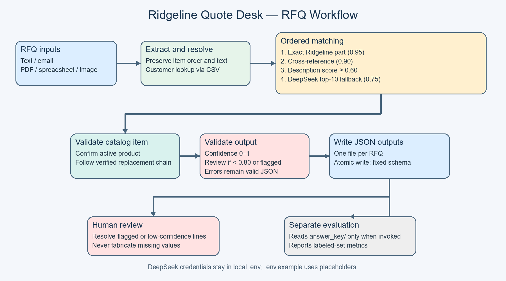
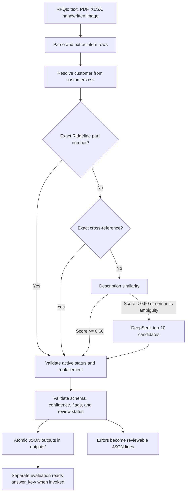

# Ridgeline Quote Desk

## Repository

Public GitHub repository: https://github.com/osamahabib5/ridgeline_industry_workflow_demo

## How to Run

In PowerShell, create and activate the project virtual environment, then install dependencies:

```powershell
python -m venv .venv
.\.venv\Scripts\Activate.ps1
python -m pip install --upgrade pip
python -m pip install -r requirements.txt
if (-not (Test-Path .env)) { Copy-Item .env.example .env }
```

Set `DEEPSEEK_API_KEY` in the local `.env` file. Never commit `.env`; `.gitignore` excludes it. Run the pipeline and, separately, the evaluator:

```powershell
python pipeline.py
python evaluation/evaluate.py
python check_submission.py
```

`pipeline.py` writes one JSON file per RFQ under `outputs/`. The evaluator reads `answer_key/` only when explicitly run and writes `evaluation/results.json`. The submission checker also creates a zip at the repository root.

## Approach

The pipeline extracts line items from text, PDF, and spreadsheet RFQs, resolves customer names against `customers.csv`, then matches direct Ridgeline part numbers, exact competitor cross-references, catalog descriptions, and finally DeepSeek candidates. Product status and `replaced_by` are checked before a match is accepted. Ambiguous, low-confidence, discontinued, or failed matches are flagged for human review. The handwritten image is intentionally emitted as a one-line stub.

The most consequential decision is to trust verified identifiers before fuzzy or model-based matching, and never let a language model override a verified exact match. Confidence below `0.80` or any flag sets `needs_review` to true. Description matches use a `0.60` threshold; LLM matches use `0.75` confidence.

The fallback provider is DeepSeek, configured with `DEEPSEEK_API_KEY`, `DEEPSEEK_MODEL`, and `DEEPSEEK_BASE_URL`. The default endpoint is `https://api.deepseek.com`; this project does not configure a geographic region, so none is claimed.

## Evaluation

`evaluation/ris_evaluation.py` compares the three labeled RFQs with their separate output files; `evaluation/evaluate.py` is a compatibility entry point. Extraction accuracy compares `as_written`, `quantity`, and `unit` by line. Match precision and recall use `needs_review` to identify auto-approved matches. `additional_metrics.item_mismatches` lists line-level missing output, extraction, and part-number mismatches with expected and actual values. The recorded `threshold` is metadata (`0.80`) and does not change the pipeline's `0.60` description-match cutoff.

The checked-in `evaluation/results.json` is an explicit placeholder because the pipeline and evaluator have not been run. The available labeled set is small; grow it with reviewed examples across all input formats, product categories, ambiguous descriptions, unit variants, discontinued items, and forwarded or messy requests. Keep separate held-out examples to limit tuning leakage.

## Production





- Keep API credentials in environment configuration; rotate keys and never include them in logs or source control.
- Validate all outputs before downstream use and route flagged or low-confidence lines to a human reviewer.
- Monitor parsing failures, unmatched rates, latency, and model/API errors; retain sanitized error details for diagnosis.
- Add reviewed RFQs to evaluation data and monitor quality separately for each file format.
- Detailed assignment-specific Part 4 requirements were not present in the repository; these bullets cover only the operational requirements stated here.
